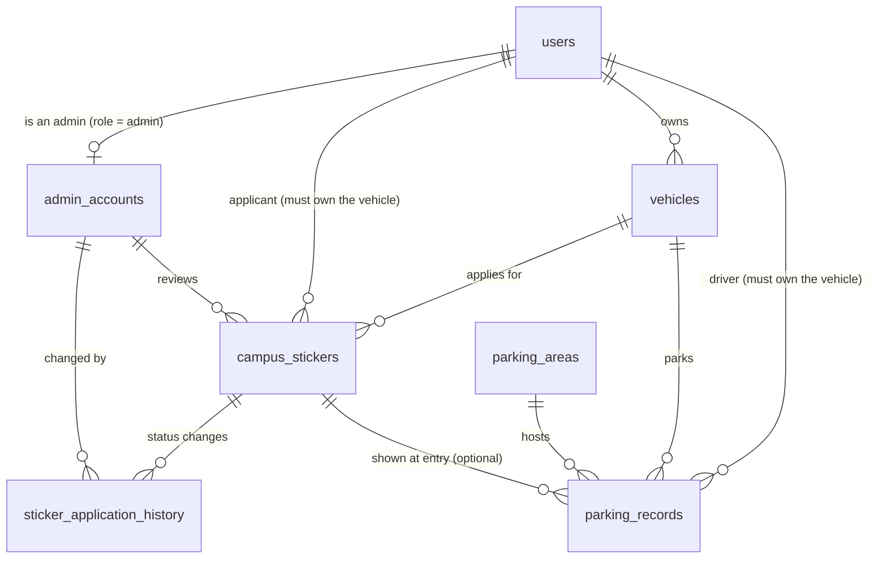
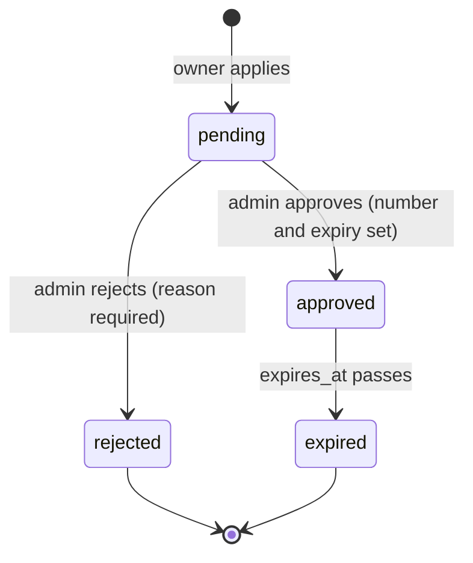

# Database structure

PostgreSQL 13+ (Neon or Supabase). The single source of truth is `src/db/schema.sql`.
The functions the code may call are listed in `docs/DATABASE_CONTRACT.md`.

## Diagram



`sticker_number_counters` (one row per year) is not drawn: it only feeds automatic sticker numbers.

## Tables

| Table | What it holds | Key rules |
|---|---|---|
| `users` | Students, faculty and admins (the login table) | email unique and lowercase; school ID unique and uppercase; `contact_number` is `+639XXXXXXXXX` or empty |
| `admin_accounts` | One row per admin user | the linked user's role must be `admin`; sticker reviewers must have a row here |
| `vehicles` | Vehicles owned by users | plate unique, uppercase, 3-15 characters; type from a fixed list; `is_active` allows deactivating instead of deleting |
| `campus_stickers` | Sticker applications and the issued stickers | statuses `pending`, `approved`, `rejected`, `expired`; one pending or approved per vehicle; approved needs a number and expiry; rejected needs a reason |
| `sticker_application_history` | Insert-only audit trail of status changes | filled by triggers; updates and deletes are refused |
| `sticker_number_counters` | Yearly counter behind automatic numbers like `2026-0001` | locked while counting, so numbers never repeat |
| `parking_areas` | Parking lots with location and capacity | name unique ignoring case; capacity above 0; valid latitude and longitude |
| `parking_records` | Each time a vehicle enters and leaves an area | `exited_at` empty means still parked; one open record per vehicle; user must own the vehicle; a sticker must belong to that vehicle |

## How the relationships protect the data

- Deleting is blocked (`ON DELETE RESTRICT`) wherever history would be lost: a user with vehicles, a vehicle with
  stickers or parking records, and an area with parking records can't be deleted. Disable or deactivate instead.
- Combined foreign keys check ownership in the database itself, so a bad API call can't create an
  application or parking record for someone else's vehicle.
- `reviewed_by` points at `admin_accounts`, so only admins can approve or reject.

## Sticker lifecycle



A rejected or expired vehicle can apply again. Every change is recorded in `sticker_application_history`.
Expiry is applied by `SELECT expire_stickers();` (run it on a schedule) and automatically when the same
vehicle submits a new application.

## SQL files

| File | Use |
|---|---|
| `src/db/schema.sql` | The whole schema. Safe to re-run: builds a new database, or upgrades an old one without losing data. |
| `src/db/reset.sql` | **Development only.** Drops every table and function and **deletes all data**. |
| `src/db/sample-data.js` | Fake students, faculty, vehicles, stickers and parking activity. |
| `src/db/migrate.js` | Runs `schema.sql` against `DATABASE_URL`. |

## Commands (run in the repo root)

```bash
npm run db:migrate   # build or upgrade the tables in DATABASE_URL
npm run db:sample    # add sample data (refuses when NODE_ENV=production)
npm test             # uses TEST_DATABASE_URL, a separate empty database; erases it first
```

Sample accounts use the password `Sample-Pass-123!`: `sample.admin@adnu.edu.ph` (admin),
`ana.reyes@gbox.adnu.edu.ph`, `ben.cruz@gbox.adnu.edu.ph`, `carla.santos@gbox.adnu.edu.ph` (students),
`miguel.delacruz@adnu.edu.ph`, `lorna.garcia@adnu.edu.ph` (faculty). They are fake: never load them into a
database with real people.

## Tests

| File | Covers |
|---|---|
| `test/db-constraints.test.js` | Every relationship, UNIQUE and CHECK rule: each test breaks one rule and expects the database to refuse |
| `test/sticker-lifecycle.test.js` | Expiry, approval history and automatic sticker numbers (including 20 simultaneous approvals) |
| `test/sample-data.test.js` | The sample data loads, covers every status and can be loaded twice safely |
